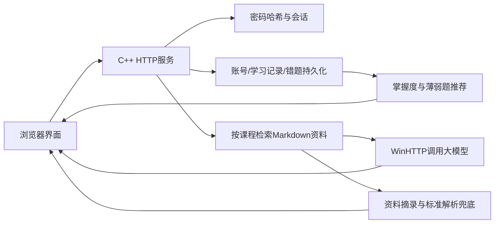

# 码上知新

面向 C++ 与数据结构学习的 Web 复习助手：练习、记录、发现薄弱知识点、基于课程资料讲解，再用不同题目验证理解。

## 已实现

- 两门课程共60道题，每门30道，每个知识点3道；普通练习最多10道、同类练习最多3道。
- 服务端注册/登录/退出；加盐 PBKDF2-HMAC-SHA256 密码哈希，HttpOnly Cookie 会话。
- 以服务端随机用户 ID 隔离学习记录和错题；不能通过修改 user_id 冒充其他用户。
- 作答落盘、网络重试去重、写入失败回滚、学习记录备份恢复。
- 按不同题目最近一次结果估计掌握度，同时显示首次正确率与题目覆盖数，重复刷同一题不能获得“已掌握”。
- 薄弱知识点优先推荐；题后辅导依据真实作答、标准解析及课程资料，支持换一道题验证。
- RAG课程答疑及资料来源；模型未配置或失败时返回资料摘录/标准解析，无证据时不调用模型。
- 前端样式、API传输、主应用和辅导组件分文件管理，保留原有页面与响应式设计。

## 架构与目录



| 路径 | 职责 |
| --- | --- |
| frontend/index.html | 页面结构与首屏主题设置 |
| frontend/css/app.css | 视觉样式与响应式布局 |
| frontend/js/api-client.js | 带Cookie的API传输与会话恢复协调 |
| frontend/js/app.js | 现有页面、练习、进度与交互 |
| frontend/js/coach.js | 针对性辅导与不同题验证组件 |
| backend/auth_store.h | 账号、密码哈希、会话、登录限流 |
| backend/learning_progress.h | 作答记录、幂等提交、掌握度统计 |
| backend/rag_retriever.* | 课程资料切块和关键词评分检索 |
| backend/llm_client.* | 原生HTTPS模型请求与JSON解析 |
| knowledge_base | 12份课程资料，cpp和data_structure两个目录 |
| tests、scripts | 编译、启动、接口/浏览器验收和检索评测 |

## 安装与运行

运行环境：Windows 10/11 x64；Visual Studio“使用C++的桌面开发”及Windows SDK；CMake/Ninja由Visual Studio提供。后端使用C++20、Windows WinHTTP、C++/WinRT、Windows CNG；cpp-httplib随仓库提供，其许可证在third_party目录。测试还需要Node.js 18或以上；浏览器验收需要Playwright及Microsoft Edge。

不依赖Python网关。无需安装前端框架即可运行；浏览器必须通过HTTP打开，不能直接双击HTML。

```powershell
Set-Location "D:\Program Files\码上新智\mashangzhixin"
.\scripts\build.ps1
.\scripts\start.ps1
```

打开 <http://127.0.0.1:8080>。正式程序是 `build/app/mashang_server.exe`，请勿再使用旧的D盘构建目录。构建前需关闭正在运行的本项目后端。

可选：Live Server使用 `http://127.0.0.1:5500`。当前允许的浏览器来源为8080和5500，前端请求携带会话Cookie。优先使用后端直接提供的页面。

## 模型配置与离线演示

复制 `.env.example` 为 `.env`，在本机填写模型地址、模型名称及密钥。模型名称须以服务商当前可用模型为准；密钥不得上传到仓库或写入前端。也支持进程环境变量 `LLM_API_KEY` / `DEEPSEEK_API_KEY`，详见模板与客户端实现。

无密钥时练习、进度、账号、错题均可运行，答疑返回本地资料，辅导返回标准解析。API失败、超时和错误响应同样有回退。模型生成状态以 `mode=generated` 为准，不把资料摘录伪装成AI生成。

```powershell
# 可选：一次真实模型连接测试，会产生服务商API用量
.\scripts\test-api.ps1
```

## 账号与数据说明

新用户请在“我的”注册服务端账号，密码至少8位。会话最长12小时，退出立即撤销，后端重启后需重新登录；账号和学习数据仍在。旧本机账号不自动变成服务器账号，旧明文密码字段在加载界面时移除。

为防止同名注册取得他人旧记录，新账号使用随机ID，不自动认领旧用户名的历史学习记录。旧数据保留，可由项目维护者在核验归属后单独迁移。账号名暂不支持修改。

未登录的guest仍是共享演示身份，不用于保存私人学习资料。无owner字段的旧错题按guest保留。头像、签名、签到、小社区等辅助功能仍为本机数据，不宣称为完整在线社交服务。

`data/accounts.json`、`data/learning_attempts.json`、`data/wrong_questions.json`及相关临时/备份文件均被Git忽略。请备份整个data目录，但不要上传其中的私人数据。学习文件损坏时可恢复上一个版本的.bak；账号文件损坏时服务拒绝启动，避免静默清空。

## API

| 方法与路径 | 用途 |
| --- | --- |
| POST /api/auth/register、/api/auth/login | 注册或登录，返回会话Cookie |
| GET /api/auth/me | 查询当前身份 |
| POST /api/auth/logout | 撤销当前会话 |
| GET /api/health | 健康检查 |
| POST /api/ask | 按课程检索与模型讲解 |
| GET /api/recommendations | 普通或同知识点练习，优先薄弱点 |
| POST /api/exercises/submit | 服务端判分、保存作答 |
| POST /api/exercises/coach | 基于当前用户已提交题目的辅导 |
| GET /api/progress | 当前用户的课程学习指标 |
| GET / POST /api/wrong-questions | 当前用户查询/保存错题 |
| PUT /api/wrong-questions/{id}/status | 更新本人错题状态 |

课程ID固定为 `cpp` 和 `data-structure`。身份由Cookie确定；传入他人用户名会返回403，不能靠user_id授权。请求示例、指标和测试见 [学习进度说明](docs/learning-progress.md)。

## 测试

关闭8080上的正式后端后依次运行。测试使用build下的独立数据目录，不写入正式账号和学习记录，不调用付费模型。

```powershell
.\scripts\test.ps1
node .\tests\learning_progress_api.cjs
node .\tests\rag_evaluation.cjs
# 浏览器验收依赖，可先 npm ci --cache ./build/npm-cache
node .\tests\hardening_acceptance.cjs
```

`npm ci --cache ./build/npm-cache`仅用于安装浏览器测试依赖，应用运行无需Node。测试环境可用 `PLAYWRIGHT_MODULE` 指定已安装Playwright的模块路径。

## 技术边界与参赛交付

目前为本机Windows演示版本，监听127.0.0.1；尚未完成公网HTTPS部署。Cookie在本机HTTP下未设置Secure，公开部署前必须配置HTTPS、Secure Cookie、部署来源及访问限制。当前RAG是关键词评分检索，不是向量检索；模型为完整响应，尚无真正SSE流式输出；辅导是受约束的工作流，不宣称自主Agent。主应用仍有待进一步组件化，尚未迁移至React/Vue或TypeScript。

检索评测见 [评测报告](docs/rag-evaluation.md)，交付材料与演示安排见 [参赛交付准备](docs/competition-delivery.md)。功能已实现并不等于正式资格审核通过；团队仍需核对赛事最新规则、组别和截止日期。

## 团队

项目主要开发：后端、AI流程、联调及工程维护。队友：资料和题目核对、评测问题、体验回归、演示讲稿与材料。正式提交前补齐姓名、学校、组别、指导教师和各自实际贡献；不得编造用户试用数据或AI效果。
